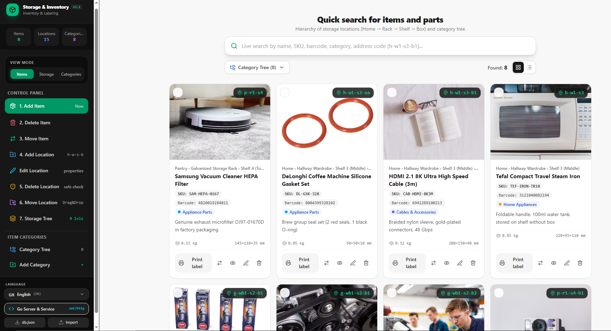

# 📦 Home & Storage Inventory Management System

An autonomous, self-hosted, lightweight inventory and hierarchical storage management system designed for organizing, labeling, and quickly retrieving items at home, in the workshop, garage, pantry, attic, or small warehouse.

Tracks appliances, spare parts, hardware fasteners, automotive components, tools, electronics, collectibles, cables, and general household items with **instant QR/barcode label generation**, **subfolder photo management**, and **zero external database dependencies**.

---

## 🌟 Key Highlights

- **Zero Cloud & Zero External DBMS**: Pure Go backend using only standard library `net/http` and thread-safe persistence in `db.json`. No PostgreSQL, MySQL, Docker, or SQLite installation required.
- **Strict 4-Level Storage Hierarchy**: `Location` &rarr; `Furniture/Rack` &rarr; `Shelf` (numbered bottom-up) &rarr; `Box/Container`.
- **Automatic Label Address Codes**: Generates short hierarchical address codes (e.g., `h-c1-s3-b1` for Home &rarr; Cabinet 1 &rarr; Shelf 3 &rarr; Box 1).
- **Physical Label Printing**: Instant Code-128 barcodes and 2D QR codes ready to print on thermal label printers or A4 sticker sheets.
- **Fast $O(1)$ Photo File Protection**: Uploaded images are categorized into subfolders named after storage locations (`uploads/<location>/`). Moving items physically moves photo files on disk, and deletions strictly purge orphaned photos without scanning the entire database.
- **Safe Deletion Protection**: Locations cannot be deleted if items are currently placed inside them.
- **Run as a Background Service**: Ready-made templates and automated scripts for **Windows 10/11 services** and **Linux systemd services**.
- **100% Offline-First & Private**: Your data stays on your local drive. Accessible by all smartphones, tablets, and PCs on your local Wi-Fi network.

---

## 📸 Interface & Workflow Walkthrough



### 1. Global Live Search & Filtering
- Instant substring filtering across item titles, descriptions, SKUs, barcodes, physical dimensions, notes, and hierarchical address codes.
- Toggle between card grid view and compact spreadsheet list view.

### 2. 4-Level Storage Tree View
- Visual tree with expand/collapse nodes and item count badges.
- Drag-and-drop to relocate shelves or containers between furniture units.
- Hover action bar for each node: **Add Child Node**, **Edit Location Properties**, **Print Location Label**, **Move Node**, and **Delete Node**.

### 3. Location Management (Create & Edit)
- Edit location **Name**, **Description**, **Marker Color**, **Code Suffix** (e.g., `b1`, `s3`), **Shelf Number** (counted from bottom up), and **Parent Location**.
- Live preview of the resulting hierarchical address code with circular dependency validation.

### 4. Label Printing (Barcodes & QR Codes)
- Printable modal rendering SVG/Canvas Code-128 barcodes and standard QR codes.
- Directly supports Brother, Dymo, Zebra label printers, and regular A4 sticker sheets.

### 5. Multi-Item Batch Actions
- Multi-select items with checkboxes to perform batch relocation to another shelf/box or batch deletion in a single operation.

---

## 🗄️ 4-Level Storage Hierarchy Explained

The system implements a structured 4-level nesting hierarchy:

| Level | Type | Examples | Address Suffix | Rules |
| :---: | :---: | :---: | :---: | :--- |
| **1** | **Location** | House, Garage, Cottage, Workshop | `h`, `g`, `w` | Root node (`parent_id = nil`). Cannot have a parent. |
| **2** | **Furniture** | Cabinet, Workbench, Metal Rack | `c1`, `wb1`, `r2` | Must be placed inside a Level 1 Location. |
| **3** | **Shelf** | Shelf 1, Shelf 2, Shelf 3 | `s1`, `s2`, `s3` | Numbered **from bottom up**. Placed inside Furniture. |
| **4** | **Container** | Box, Bin, Tool Case, Organizer | `b1`, `b2`, `orgA` | Placed on a Shelf or directly inside Furniture. |

### Label Address Example:
- Full code: `h-c1-s3-b1`
  - `h`: House (Location)
  - `c1`: Cabinet 1 (Furniture)
  - `s3`: Shelf 3 (Shelf, counted from the floor up)
  - `b1`: Box 1 (Container)

---

## 📸 Photo Storage & Automatic Disk Maintenance

Photos are stored directly on the local filesystem with structured isolation:

1. **Subfolder Partitioning by Location**:
   - Files are automatically placed into: `./uploads/<full_code>_<location_name>/`.
   - Example: `./uploads/h-c1-s3-b1_Box_1_Cables/item-1_1700000000_a1b2.jpg`.
2. **Item-ID Prefix Protection**:
   - Every file begins with its owning item's sanitized ID: `[item_id]_[timestamp]_[rand].[ext]`.
   - When deleting or moving photos, the Go backend performs a fast $O(1)$ prefix check to guarantee that no files belonging to other items sharing the same folder are ever touched.
3. **Physical File Relocation on Item Move**:
   - When an item is moved to another box, shelf, or room, the server physically moves the image files on disk into the target location's subfolder and updates `db.json`. Empty source subfolders are cleaned up automatically.
4. **Instant Cleanup on Cancellation**:
   - If an image is uploaded in the Add/Edit modal but the user cancels or closes the dialog, the file is immediately purged from the server via `DELETE /api/upload`.

---

## 💾 Backup & Disaster Recovery Guide

> **CRITICAL**: To create a full backup of your inventory, you only need to preserve **TWO** items:
> 1. `db.json` — The complete relational database file (items, locations, categories, parameters, barcodes).
> 2. `uploads/` — The directory containing all uploaded item photographs organized by location subfolders.

### What Files to Save:
```
your-inventory-folder/
├── db.json        <-- 🔴 REQUIRED: Your complete database
└── uploads/       <-- 🔴 REQUIRED: All item photos
```

### Automated Backup Scripts:

#### On Windows 10/11:
Run the included backup script:
```cmd
scripts\backup.bat
```
This automatically produces a timestamped ZIP archive in the `backups\` folder:
`backups\inventory_backup_YYYY-MM-DD_HH-MM-SS.zip`.

#### On Linux / macOS:
```bash
bash scripts/backup.sh
```
This creates a timestamped `tar.gz` archive in `backups/`.

### How to Restore:
1. Place your saved `db.json` file and `uploads/` folder into the application root directory (next to the executable).
2. Start the server. The application will instantly load all your data and images without any migration steps or database configuration.

---

## ⚙️ Running as a System Service

To keep the inventory server running in the background automatically when your computer starts (even before user login), set it up as a system service.

### 🪟 Windows 10 / 11 Service Setup

You can register the service using either **NSSM (Recommended)** or standard Windows **sc.exe**.

#### Method 1: Automated Script (Recommended)
1. Build `inventory.exe` (see [Build Instructions](#-building-from-source)).
2. Right-click `scripts\install-windows-service.bat` and select **"Run as administrator"**.
3. The script will automatically configure and start the service.

#### Method 2: Using NSSM (Non-Sucking Service Manager)
1. Download NSSM from [nssm.cc](https://nssm.cc/download) and place `nssm.exe` in your system `PATH` (or in the project folder).
2. Open PowerShell / Command Prompt as **Administrator**:
   ```cmd
   nssm install HomeInventory "C:\path\to\your\inventory.exe"
   nssm set HomeInventory AppDirectory "C:\path\to\your\folder"
   nssm set HomeInventory Description "Home Inventory Hierarchical Management Server"
   nssm set HomeInventory Start SERVICE_AUTO_START
   nssm start HomeInventory
   ```

#### Method 3: Using Native Windows `sc.exe`
Open Command Prompt as **Administrator**:
```cmd
sc create HomeInventory binPath= "\"C:\path\to\inventory.exe\"" start= auto DisplayName= "Home Inventory Server"
sc description HomeInventory "Home Inventory and Hierarchical Storage Management Service"
sc start HomeInventory
```

#### Windows Service Commands:
```cmd
net start HomeInventory     :: Start service
net stop HomeInventory      :: Stop service
sc query HomeInventory      :: Check status
scripts\uninstall-windows-service.bat  :: Remove service
```

---

### 🐧 Linux Systemd Service Setup (Ubuntu, Debian, Fedora, Arch, Raspberry Pi)

A systemd unit file is provided at `scripts/home-inventory.service`.

#### Method 1: Automated Installer
```bash
sudo bash scripts/install-service-linux.sh
```

#### Method 2: Manual Systemd Setup
1. Copy your compiled binary and assets to `/opt/home-inventory`:
   ```bash
   sudo mkdir -p /opt/home-inventory/uploads
   sudo cp go-backend/inventory-linux /opt/home-inventory/inventory-linux
   sudo cp -r go-backend/web /opt/home-inventory/web
   sudo chmod +x /opt/home-inventory/inventory-linux
   ```
2. Copy the systemd service file:
   ```bash
   sudo cp scripts/home-inventory.service /etc/systemd/system/home-inventory.service
   ```
3. Reload systemd, enable at boot, and start:
   ```bash
   sudo systemctl daemon-reload
   sudo systemctl enable home-inventory
   sudo systemctl start home-inventory
   ```

#### Linux Service Commands:
```bash
sudo systemctl status home-inventory    # Check service status
sudo journalctl -u home-inventory -f     # View live logs
sudo systemctl restart home-inventory   # Restart service
sudo systemctl stop home-inventory      # Stop service
```

---

## 🔨 Building from Source

### Prerequisites:
- **Node.js** v18+ and **npm**
- **Go (Golang)** v1.20+ ([Download Go](https://go.dev/dl/))

### 1. Build the Frontend Web Assets
```bash
# Install frontend dependencies
npm install

# Build production bundle (outputs to dist/ and automatically copies to go-backend/web/)
npm run build
```

### 2. Build the Go Backend Executable

#### For Windows (64-bit):
```bash
cd go-backend
go build -ldflags="-s -w" -o inventory.exe main.go
```
*Creates a standalone `inventory.exe` (~10MB) that can be run on any Windows 10/11 machine without Go installed.*

#### For Linux (x86_64):
```bash
cd go-backend
GOOS=linux GOARCH=amd64 go build -ldflags="-s -w" -o inventory-linux main.go
chmod +x inventory-linux
./inventory-linux
```

#### For Raspberry Pi (ARM64):
```bash
cd go-backend
GOOS=linux GOARCH=arm64 go build -ldflags="-s -w" -o inventory-rpi main.go
```

#### For macOS (Apple Silicon / Intel):
```bash
cd go-backend
# Apple Silicon (M1/M2/M3/M4):
GOOS=darwin GOARCH=arm64 go build -ldflags="-s -w" -o inventory-mac main.go

# Intel Mac:
GOOS=darwin GOARCH=amd64 go build -ldflags="-s -w" -o inventory-mac-intel main.go
```

---

## ⚖️ Advantages & Limitations

### Advantages:
1. **Zero External Dependencies**: Single binary embeds everything. No need to install PostgreSQL, MySQL, Redis, or Docker.
2. **Transparent Storage**: `db.json` is human-readable JSON. You can open and view your entire database in Notepad or VS Code at any time.
3. **True Offline Operation**: Operates 100% locally without internet connectivity. Perfect for remote cottages, basements, or secure facilities.
4. **Mobile Camera Barcode & Photo Scanning**: Mobile web interface uses `capture="environment"` to snap direct photos without cluttering personal camera rolls.
5. **Fast $O(1)$ Photo Security**: Avoids costly full-database scans on disk operations; strictly isolates photos by unique item ID.
6. **Blazing Fast Startup**: Starts in less than 20 milliseconds, uses less than 25MB of RAM.

### Limitations:
1. **Single-Node Architecture**: Uses a local file lock (`sync.RWMutex`). Designed for single-server setups (home, workshop, warehouse office), not distributed multi-region cloud clusters.
2. **Local Disk Concurrency**: Best suited for households, workshops, and small businesses with up to tens of simultaneous users.
3. **Payload Limit**: Maximum upload photo payload is configured to 15MB per image (can be tuned in `handlers.go`).

---

## 📡 REST API Reference

All endpoints return and accept JSON, unless specified otherwise.

### Items (`/api/items`)
| Method | Path | Description |
| :--- | :--- | :--- |
| `GET` | `/api/items?q={query}&location_id={id}` | Search items across title, SKU, barcode, location |
| `POST` | `/api/items` | Create a new inventory item card |
| `PUT` | `/api/items/{id}` | Update item card (relocates photos if location changed) |
| `DELETE` | `/api/items/{id}` | Delete item and permanently purge its photos from disk |
| `POST` | `/api/items/move` | Batch move items to another location ID |

### Locations (`/api/locations`)
| Method | Path | Description |
| :--- | :--- | :--- |
| `GET` | `/api/locations` | Get complete 4-level storage hierarchy tree |
| `POST` | `/api/locations` | Create a new location node |
| `PUT` | `/api/locations/{id}` | Update location properties (name, code suffix, color, shelf number) |
| `DELETE` | `/api/locations/{id}` | Delete location (**blocked** if items exist inside) |
| `POST` | `/api/locations/move` | Move a location/shelf node with cycle protection |

### Categories (`/api/categories`)
| Method | Path | Description |
| :--- | :--- | :--- |
| `GET` | `/api/categories` | Get hierarchical catalog categories |
| `POST` | `/api/categories` | Create a new category |
| `PUT` | `/api/categories/{id}` | Rename or update category properties |
| `DELETE` | `/api/categories/{id}` | Delete category (safely reassigns items) |
| `POST` | `/api/categories/move` | Relocate category under a different parent |

### Uploads (`/api/upload`)
| Method | Path | Description |
| :--- | :--- | :--- |
| `POST` | `/api/upload` | Multipart form upload (`photo`, `item_id`, `location_id`) |
| `DELETE` | `/api/upload` | Immediate file deletion (`path`, `item_id`) |
| `GET` | `/uploads/{path...}` | Static file server for uploaded item images |

---

## 📄 License

Licensed under the [Apache-2.0 License](LICENSE).

## 💖 Support the Project

If this project has saved you time or helped you in your work, consider supporting its further development. You can send a donation using crypto networks or directly via Telegram:

*   💎 **GRAM / TON (The Open Network):**
*     `UQCjN9if4bTewLNJRYaUdeaSdziQlNLgPuHN39t1Vlzlmrdp`
* 
*   💵 **USDT (TRC-20 / Tron network):**
*     `TGxa9vYFV6VBeb37GHh8GnuAuARji9PT1v`
* 
*   📱 **Telegram Wallet (No fees):** 
    Send directly to username: `@technokhv`

---
⚠️ *Note for USDT: Please ensure you are sending via the **TRC-20 (Tron)** network. Sending to the wrong network will result in a permanent loss of funds.*

